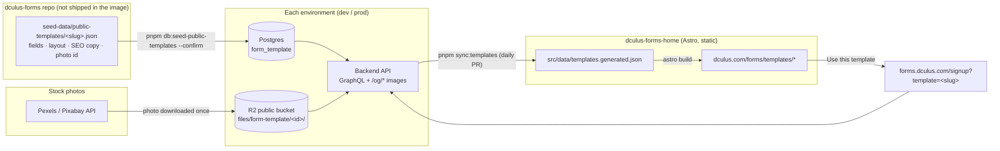
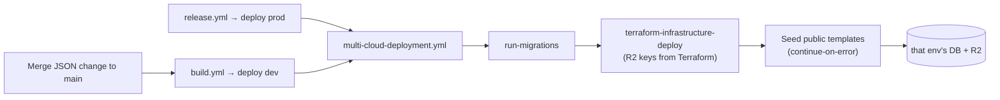
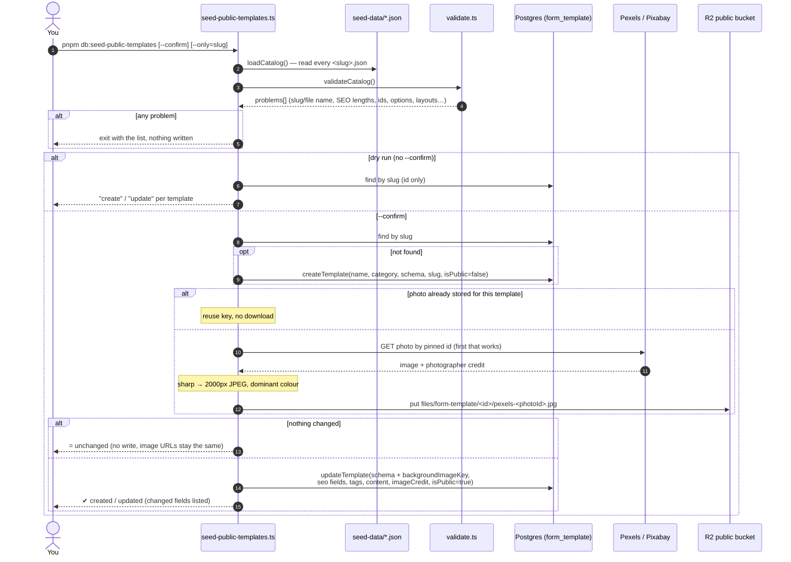
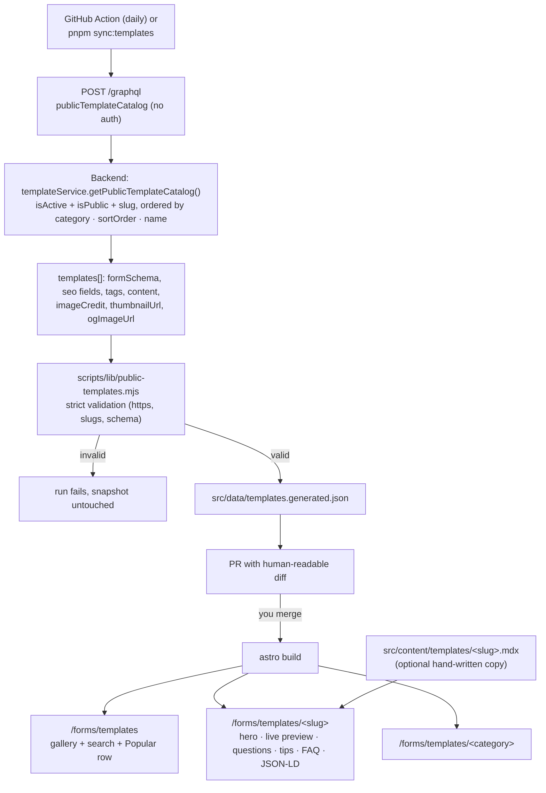
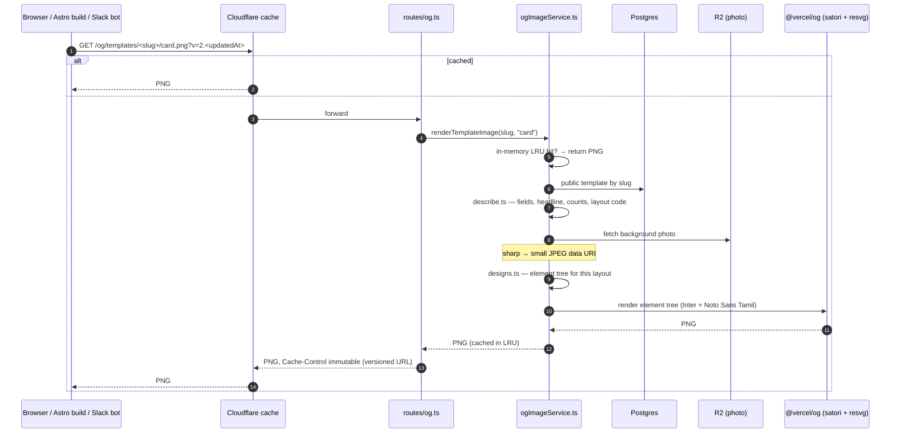
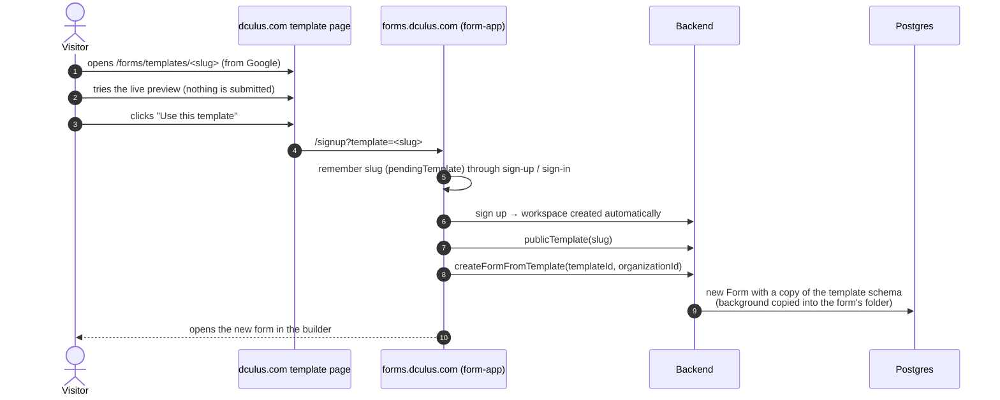
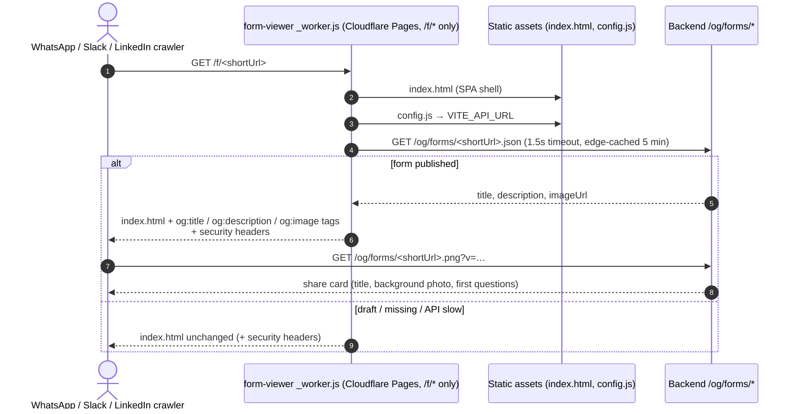

# Public templates — technical flow

How a template goes from a JSON file to a page on dculus.com, how its images are made,
and how a visitor turns it into their own form. Six flows:

1. [Big picture](#1-big-picture)
2. [Seeding a template into an environment](#2-seeding-a-template-into-an-environment)
3. [Landing site build (dculus.com)](#3-landing-site-build-dculuscom)
4. [Generated images (thumbnail and share card)](#4-generated-images-thumbnail-and-share-card)
5. [Visitor uses a template](#5-visitor-uses-a-template)
6. [Sharing a published form link](#6-sharing-a-published-form-link)

---

## 1. Big picture

The running app reads templates **only from the database**. The JSON files are seed data:
they live outside `src/`, are not compiled, and `.dockerignore` keeps them out of the image.

---

## 2. Seeding a template into an environment

`apps/backend/src/scripts/seed-public-templates.ts`. It runs **automatically on every
deploy** (GitHub Actions, see below), and you can also run it from a checkout whose `.env`
points at an environment (dev by default).

Re-running is safe: matched by **slug** (no duplicates), field ids come from the file, and
the photo is only downloaded when the pinned id changes.

---

## 3. Landing site build (dculus.com)

On the template page:

| Part | Comes from |
|---|---|
| `<title>`, meta description | `seoTitle`, `seoDescription` |
| Hero thumbnail, gallery card | `thumbnailUrl` → backend `/og/templates/<slug>/card.png` |
| `og:image` | `ogImageUrl` → backend `/og/templates/<slug>.png` |
| Live preview | `@dculus/form-renderer` (the real form renderer) + `formSchema` |
| "What this template asks" | `formSchema` fields, rendered as HTML |
| Who it's for / tips / FAQ | `content` (+ MDX + standard FAQ) |
| Photo credit | `imageCredit` |

---

## 4. Generated images (thumbnail and share card)

`apps/backend/src/routes/og.ts` → `services/og/*`. Images are **drawn**, not screenshotted:
`designs.ts` is a simplified, hand-written copy of each layout (L1–L9). It reads the same
template data as the real form but is separate drawing code, with fixed limits (first 3
options per question, labels cut at ~34 chars, questions until the space is used).

| URL | Size | Used for |
|---|---|---|
| `/og/templates/<slug>/card.png` | 1200×800 | Gallery card + template hero |
| `/og/templates/<slug>.png` | 1200×630 | Template page share image |
| `/og/forms/<shortUrl>.png` | 1200×630 | Published form share image |
| `/og/forms/<shortUrl>.json` | — | Title/description/image for link previews |

The `?v=` version = `OG_DESIGN_VERSION` + the template's last edit, so editing a template or
bumping the design version creates a new URL instead of waiting for caches to expire.

---

## 5. Visitor uses a template

---

## 6. Sharing a published form link

Cloudflare doesn't apply `_headers` to worker responses, so the worker re-adds the `/*`
security headers itself (a test keeps them in sync). Every other path (`/embed/*`, assets)
never reaches the worker.

---

## Files at a glance

| Step | Files |
|---|---|
| Template data | `apps/backend/seed-data/public-templates/*.json` |
| Load + validate | `apps/backend/src/publicTemplates/{loadCatalog,validate,photos,types}.ts` |
| Seed / preview CLIs | `apps/backend/src/scripts/{seed,preview}-public-templates.ts` |
| DB model | `form_template` in `apps/backend/prisma/schema.prisma` |
| API | `templateService.ts`, `graphql/resolvers/templates.ts` (`publicTemplateCatalog`) |
| Images | `apps/backend/src/services/og/*`, `apps/backend/src/routes/og.ts` |
| Link previews | `apps/form-viewer/public/_worker.js`, `_routes.json`, `_headers` |
| Owner's preview | `apps/form-app/src/components/sharing/ShareLinkPreview.tsx` |
| Landing sync | `dculus-forms-home/scripts/{sync-templates.mjs,lib/public-templates.mjs}` |
| Landing pages | `dculus-forms-home/src/pages/forms/templates/*`, `src/lib/templates.ts` |
| Sign-up from template | `apps/form-app/src/lib/pendingTemplate.ts`, `components/PendingTemplateHandler.tsx` |

More detail (field types, layouts, SEO rules): [TEMPLATE_AUTHORING.md](./TEMPLATE_AUTHORING.md).
